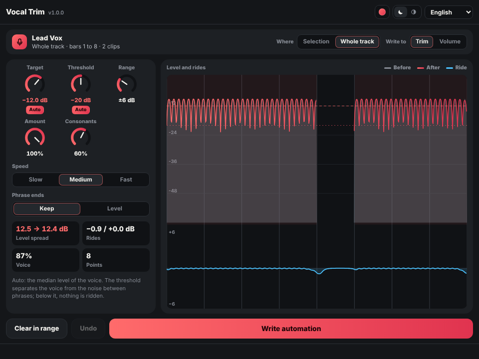
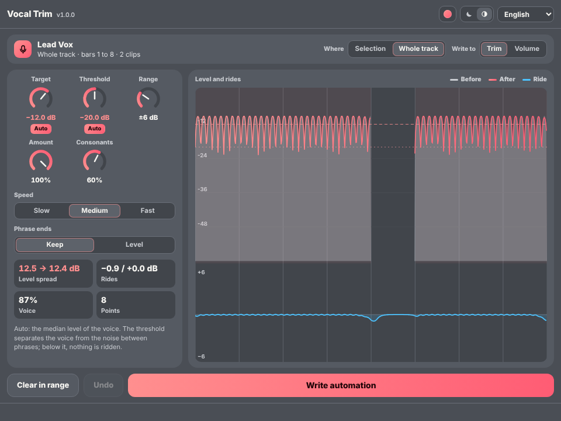

# Vocal Trim for LUNA

Vocal Trim reads the level of a vocal track in LUNA and writes the gain changes that keep it
near a target level, the way an engineer rides the fader. It writes them as automation on the
track's **Trim** lane, so the fader stays free for the mix. It can also write them on the
**Volume** lane.

  
  

## Features

- **Whole track or selection:** works on the whole vocal track or on the range you select in LUNA.
- **Trim or Volume:** writes to the track's input Trim lane (the fader stays free) or to the Volume lane.
- **Before and after preview:** the voice's level before and after, the target, the threshold and
  the gain curve it will write, updated as you turn the knobs.
- **Target and threshold:** set by hand or worked out from the vocal (Auto). Below the threshold,
  between phrases, nothing is changed, so breaths and noise are not pulled up.
- **Range, amount and speed:** how far it may move (±1 to ±18 dB), how much of the correction it
  applies, and how closely it follows the voice (slow, medium or fast).
- **Phrase ends:** **Keep** leaves the natural fall at the end of each phrase alone instead of
  pulling it back up; **Level** evens it out too.
- **Consonants:** pulls down short peaks, like loud plosives and hard consonants, even inside a
  phrase that is being raised.
- **Safe:** the points stay inside the control's range, the track is set to read automation so
  you hear the result, and Clear and Undo remove what it wrote.
- **Your colour:** yellow, orange, red, green, blue, pink or purple; dark and grey themes.
- **7 languages:** English, Español, Català, Français, Deutsch, Italiano and Português.

## How to use it

1. In LUNA, select the vocal track, and a range on it if you only want part of the song.
2. In **Vocal Trim**, choose **Selection** or **Whole track**, and **Trim** or **Volume**.
3. Adjust the target, range and the rest while you watch the preview.
4. Press **Write automation** and play. Undo with the **Undo** button or Cmd+Z in LUNA.

Tip: ±6 to ±9 dB of range is usually enough for a vocal.

## Support

If something does not work as expected, Alt-click the version number at the top of the window:
it copies a short report to paste in a message to fedetrillo@gmail.com.

## Install

Requires LUNA 3.1.2 or later. Install it from LUNA's Add On marketplace, or download
`vocaltrim.lunaaddon` from the latest release and double-click it. Then open a session and
choose **Add Ons > Windows > Vocal Trim**.

## En español

Vocal Trim lee el nivel de una pista de voz en LUNA y escribe en el carril de Trim los cambios
de ganancia que la mantienen cerca de un nivel objetivo, como un técnico que sube y baja el
fader. Respeta la caída natural de los finales de frase y baja las consonantes fuertes. El fader queda libre para la mezcla. Vista previa de antes y después, modo
oscuro y gris, siete colores, 7 idiomas.

## Licence

Copyright (c) 2026 Fede Trillo. All rights reserved. Free to install and use in LUNA; the code
may not be copied, modified or redistributed. See [LICENSE](LICENSE). The bundled LUNA Builder
SDK is Universal Audio's, under the Apache License 2.0: see
[THIRD_PARTY_NOTICES.md](THIRD_PARTY_NOTICES.md).

Contact: fedetrillo@gmail.com
